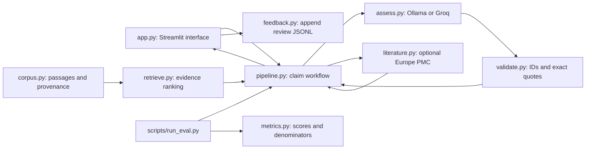
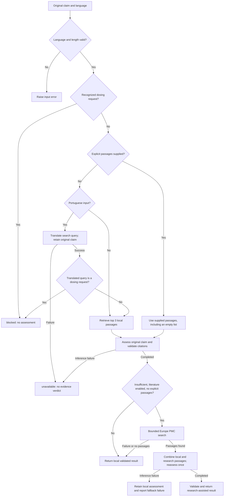
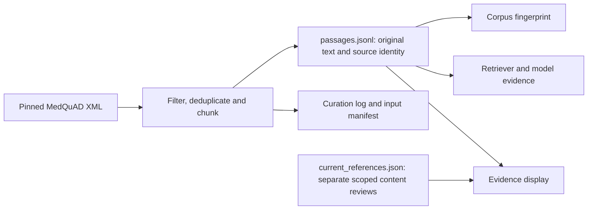
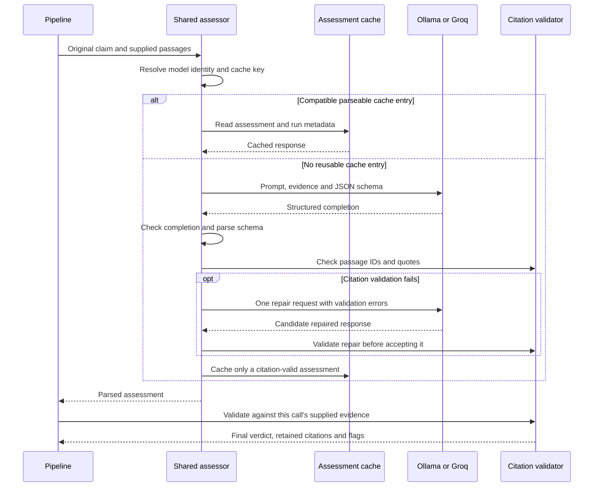
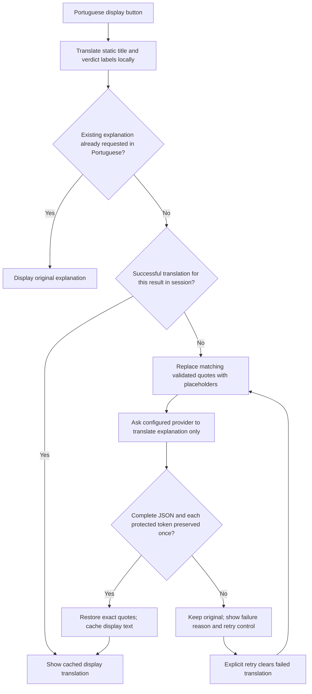
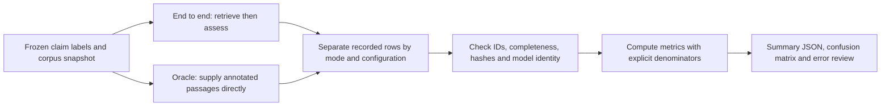

# How to review the GlucoTrust Lite codebase

A guided reading and review plan for understanding the prototype, tracing its
behavior, and judging changes. Written against the code on **2026-11-04**.
Follow the linked functions in your editor; Mermaid diagrams render in GitHub's
Markdown preview or an editor with Mermaid support.

The central review question is: **Can I trace a displayed conclusion back to the
actual supplied evidence, understand how it could be wrong, and reproduce the
recorded experiment?** This is a research prototype with provisional annotations,
not a clinically validated system.

## 1. Start with the mental model

The application implements retrieval-augmented generation, or **RAG**:

1. Find short text passages related to a claim.
2. Supply those passages and the original claim to a language model.
3. Parse its structured response and validate its citations.
4. Show the result, evidence, provenance and optional reviewer feedback.

No language model is trained or fine-tuned by this repository. Retrieval selects context;
it does not establish that a claim is true. The model interprets that context;
its interpretation may be wrong even when its quotation is real.



Arrows show the main flow of data or orchestration, not every Python import.

### Vocabulary you will encounter

| Concept | Meaning here | Where to inspect it |
|---|---|---|
| Corpus | The collection of searchable source passages. | [corpus.py](../src/glucotrust/corpus.py), [dataset notes](../data/curated/README.md) |
| Passage / chunk | A small excerpt with an ID, question, text and source metadata. Local and research passages have different provenance. | `Passage`, `chunk_answer()` in [ingest.py](../src/glucotrust/ingest.py) |
| Embedding | A numeric vector representing text for semantic similarity. It is not a diagnosis or a truth score. | `DenseRetriever` in [retrieve.py](../src/glucotrust/retrieve.py) |
| BM25 | A lexical ranking method based on query terms and their distribution in documents. | `BM25Retriever` |
| Cosine similarity | Directional similarity between vectors. For normalized vectors, their dot product gives cosine similarity. | `DenseRetriever.search()` |
| Top-k | The number of highest-ranked passages selected. The local workflow uses three. | `assess_claim()` in [pipeline.py](../src/glucotrust/pipeline.py) |
| Structured output | A response constrained to fields and types, such as a verdict, citations and explanation. Valid structure does not prove valid reasoning. | Pydantic models in [validate.py](../src/glucotrust/validate.py) |
| Entailment | Whether the evidence actually establishes the conclusion. Exact-quote validation does not test this. | [adversarial review](adversarial-review.md) |
| Abstention | An insufficient-evidence verdict. A validator downgrade can also produce that displayed verdict, so inspect its reason. | `validation_failed`, evaluation summaries |
| Oracle setting | Give annotated evidence directly to the assessor to examine interpretation with a controlled context. | [run_eval.py](../scripts/run_eval.py) |
| Fingerprint | A hash identifying a particular input/configuration snapshot. It detects differences, not scientific quality. | `fingerprint()` and assessment cache identity |
| Mock / dependency injection | Substitute a controlled retriever, encoder or client to test behavior without external services. | [test_retrieve.py](../tests/test_retrieve.py), [test_groq.py](../tests/test_groq.py) |

## 2. Follow this reading order

A first pass can take roughly 60–90 minutes; return to provider and UI details
when reviewing a change in those areas. Read one implementation beside its tests.

| Order | Read | What you should be able to explain afterwards |
|---|---|---|
| 1 | [README](../README.md), [pyproject.toml](../pyproject.toml) | Project purpose, supported Python version, dependencies, current prompt versus historical evaluation scope. |
| 2 | [corpus.py](../src/glucotrust/corpus.py), [validate.py](../src/glucotrust/validate.py) | The inputs and outputs: `Passage`, `Citation`, `Assessment`, `ValidatedAssessment`. |
| 3 | [pipeline.py](../src/glucotrust/pipeline.py) | The branches in `assess_claim()` and the fields in `ClaimResult`. |
| 4 | [retrieve.py](../src/glucotrust/retrieve.py) | How the query becomes three `SearchHit` objects and what each score means. |
| 5 | [assess.py](../src/glucotrust/assess.py) | Prompt/schema, provider selection, response parsing, one citation repair, caching and unavailable outcomes. |
| 6 | [literature.py](../src/glucotrust/literature.py) | When outside evidence is requested, how it is bounded, and what happens on failure. |
| 7 | [app.py](../app.py), [feedback.py](../src/glucotrust/feedback.py), [style.css](../assets/style.css) | Session state, translation controls, evidence rendering, feedback persistence and actual mouse interactions. |
| 8 | [metrics.py](../src/glucotrust/metrics.py), [run_eval.py](../scripts/run_eval.py), [compare_retrieval.py](../scripts/compare_retrieval.py) | What is measured, which denominator is used, and whether runs are comparable. |
| 9 | [ingest.py](../src/glucotrust/ingest.py), [build_corpus.py](../scripts/build_corpus.py), [check_provenance.py](../scripts/check_provenance.py) | How the source snapshot was constructed and how provenance changes affect reproducibility. |

In each file, first find the public entry point, then trace its return values,
exceptions and side effects. Mark operations that make network requests or write
files. Ask what its caller assumes and which test demonstrates that contract.

### Python patterns worth recognizing

- **Pydantic models** validate external/serialized data. `extra="forbid"` rejects
  unexpected fields; `Passage` is frozen to prevent ordinary field mutation.
- **Dataclasses**, including `SearchHit` and `ClaimResult`, group runtime values.
  They do not provide the same input validation as a Pydantic model.
- **Exceptions** such as `AssessmentUnavailable` represent failure to run the
  operation. Follow the `except` branch to see what the user receives.
- **Injected objects** keep orchestration independent of a particular backend:
  the pipeline calls `retriever.search()` and `assessor.assess()`.
- **Private methods/classes** prefixed with `_` are implementation details.
  Inspect `_StructuredAssessor` because both providers share its behavior.

## 3. Trace one claim through the workflow

Use the existing public example: “Early diabetic kidney disease can occur
without symptoms.” The example has an annotated passage; a new model run is not
guaranteed to reproduce a particular verdict.

Start at the claim form in `app.py`, then step into `assess_claim()`.



`passages=None` means retrieval is needed. `passages=[]` means deliberately supply
no evidence. That distinction is essential to the oracle evaluation and to
preventing outside search from silently changing the experiment.

### Distinguish status from verdict

| Field / value | Interpretation |
|---|---|
| `status="assessed"`, verdict `supported` | The model's support conclusion passed technical citation validation. Semantic correctness is still open to review. |
| `status="assessed"`, verdict `contradicted` | The model asserts an incompatible fact is established by the evidence. Missing support alone should not justify this. |
| Verdict `insufficient`, `validation_failed=False` | A model-originated abstention after successful parsing/validation. It can still be an incorrect interpretation. |
| Verdict `insufficient`, `validation_failed=True` | Citation checks forced a downgrade. This is distinct from the model deciding evidence was insufficient. |
| `status="unavailable"`, no assessment | Inference or search-query translation could not complete. Do not interpret this as an evidence verdict. |
| `status="blocked"`, no assessment | A recognized personal dosing request was rejected. The guard is a limited heuristic. |

A failed **literature reassessment** can retain `status="assessed"` because a local
assessment already exists. Inspect `result.literature["status"]` too. Input and
retrieval errors can instead reach the app's outer exception handler.

**Review exercise:** for the example, identify the original claim, retrieval
query, passage IDs, final verdict, validation flags, model identifier and prompt
version. If the result is insufficient, determine whether the cause is missing
support, interpretation, or failed citation validation.

## 4. Review the data and retrieval contracts

### Corpus and provenance

Read [ingest.py](../src/glucotrust/ingest.py) with
[test_ingest.py](../tests/test_ingest.py).
The builder filters on focus/question, checks answer-word overlap for near
duplicates, uses deterministic source order and chunks answers into passages of
at most 150 words. The included snapshot contains 60 records and 199 passages.



Review [current_references.json](../data/curated/current_references.json) and
[source-review.md](source-review.md). Supplementary current links are displayed;
the linked page contents are not automatically supplied to the assessor.
A URL returning HTTP 200 does not verify its medical content. `checked_on` is not
a guarantee of freshness, and a `retrieved` research excerpt is not a guideline.

`check_provenance.py` writes updated passage metadata and a URL-check report;
`build_corpus.py` rebuilds the corpus. These are not read-only inspection commands.
Changing metadata can change the fingerprint and invalidate recorded experiments.

### Retrieval

Read [retrieve.py](../src/glucotrust/retrieve.py) beside
[test_retrieve.py](../tests/test_retrieve.py).

- BM25 indexes `question + text` with lowercase ASCII tokenization.
- MiniLM embeds `question + text`, normalizes vectors and ranks cosine scores.
- Both expose `search(query, k)` and return passage objects with scores.
- Embedding caches include model name, the configured revision and corpus fingerprint.
  The local model-download path also matters: inspect the pinned download script.

**Review questions:** Does the same query/corpus reach both methods in a comparison?
Does an embedding cache become stale if evidence changes? Are ties stable? What
happens for an empty corpus or invalid `k`? Could a relevant passage simply be
absent from the annotated gold IDs?

Neither a large cosine score nor a BM25 score is calibrated confidence in a medical
claim. BM25 and dense score magnitudes are not directly comparable. The English
retriever is also why Portuguese input has a separate search-translation step.

## 5. Review model responses and citation validation

Read `SYSTEM_PROMPT`, `_StructuredAssessor.assess()`, the two `_chat()` methods,
then `validate_assessment()` and [test_validate.py](../tests/test_validate.py).



The diagram shows completed/parseable paths. Missing models, authentication or
quota errors, malformed JSON and incomplete generation can raise
`AssessmentUnavailable` before a usable assessment is returned.

The validator checks IDs against the supplied passages, matches quote substrings
after **whitespace normalization**, and requires citations for support or
contradiction. A failure forces insufficient, drops invalid citations and replaces
the explanation with a warning. A failed repair must not promote invalid support.

There are two different contracts to review:

1. **Structural validity:** Does the JSON conform to `Assessment`?
2. **Textual validity:** Is the cited quote present in a supplied passage?

Neither contract establishes **semantic entailment**. In the deliberately
constructed `adv-04` counterexample, a real bladder-anatomy quotation cannot
establish that a forecasting algorithm never misses hypoglycemia, yet textual
validation can accept it. This is a validator-boundary demonstration, not an
observed model output. Read
`test_adversarial_quotes_are_exact_but_cannot_prove_entailment()` in
[test_evaluation_integrity.py](../tests/test_evaluation_integrity.py).

### Provider and cache review

Ollama uses its Python client's structured format; Groq uses HTTP JSON-schema
requests. The shared assessor owns parsing, repair and caching. Inspect
[test_sdk_contract.py](../tests/test_sdk_contract.py),
[test_assess.py](../tests/test_assess.py) and [test_groq.py](../tests/test_groq.py).

Check cache identity for provider/host, requested model, generation settings,
response language, prompt text/version, schema, original claim and passage
fingerprint/order. Ollama resolves a model digest even when a cache entry exists.
Groq uses a deployment revision and UTC date; a hosted alias does not identify
immutable weights. A hash cannot prove that an answer is correct.

Review the cache's temporary-file replacement and its write-failure behavior:
completed inference should remain usable if the cache cannot be written.
Never copy credentials into cache identities, result artifacts or user-facing errors.

## 6. Review external literature and bilingual behavior

### Europe PMC fallback

Read [literature.py](../src/glucotrust/literature.py) beside
[test_literature.py](../tests/test_literature.py).
The implementation searches title/abstract topic terms, requests up to five
records, tries broader OR terms only if AND search returns no records, and ranks
usable passages using BM25. It combines up to three research passages with the
local hits for one reassessment.

The review should cover fixed API URLs, allowed identifiers, timeouts, a response
size limit, XML entity rejection, abstract fallback, and visible source metadata.
Titles alone are not evidence. Removing negation from *search terms* must not
remove negation from the *claim being assessed*. These bounds improve auditability;
they do not make the search exhaustive or establish article relevance.

BVS/LILACS and SciELO are feasibility candidates, not implemented providers.
See [Portuguese sources](portuguese-sources.md).

### Two separate translation operations

| Operation | Input and purpose | What must remain intact |
|---|---|---|
| `translate_query()` | Portuguese claim → English retrieval query, also used for literature search. | Assess the original claim; preserve negation/quantities in the search translation; translation is never evidence. |
| `translate_summary()` | Existing explanation → Portuguese display text. | Keep the original assessment, verdict and citations; protect matching validated quotations and restore them exactly. |



This diagram describes a normal completed assessment. A validation-downgraded
assessment uses a fixed Portuguese warning in the UI. With no result, the button
only changes static display text. Switching to Portuguese also clears a cached
translation failure. Successful translations are reused. Nothing in the display
translation proves the meaning of unquoted explanatory text was preserved.

Read [test_bilingual.py](../tests/test_bilingual.py) and
[test_display_translation.py](../tests/test_display_translation.py).
Check that toggling/retrying does not call retrieval or assessment again.
Static title translation can work while a separate provider request fails.

## 7. Review the UI, persistence and deployment boundary

Read `resources()`, `highlighted()`, form submission and translation callbacks in
[app.py](../app.py), then [feedback.py](../src/glucotrust/feedback.py).

Streamlit reruns the script on interactions. `st.session_state` preserves a
session's result, saved-feedback flag, display language and summary translation.
`st.cache_resource` reuses the retriever; it is separate from the disk embedding
cache and the assessment-response cache.

Review these specific contracts:

- New claim submission clears the previous result, feedback flag and display translation.
- Rendering escapes corpus/model text before adding quote highlights to HTML.
- Source/current-reference labels do not imply those pages were model evidence.
- The translation control is below the custom header. A transparent fixed toolbar
  can intercept mouse clicks even when accessibility-based activation succeeds.
- `app.py` prioritizes checked-out `src/` imports. A stale installed package once
  lacked the new `language` argument; pytest's configured source path could hide
  that deployment mismatch. Read [test_deployment_import.py](../tests/test_deployment_import.py).
- App-level errors identify retrieval versus assessment stages. Server logs and
  user messages should remain useful without exposing secrets or personal data.

Feedback appends a JSONL record containing the original claim, verdict, passage
IDs, model/prompt, validation flag, correctness choice, bounded note, literature
metadata and timestamp. It does **not** serialize the full `ClaimResult.run`
trace. Review what is actually persisted before assuming translations or complete
inference traces can be reconstructed from feedback alone. Cloud-local files
are not a durable reviewer database, and a saved review is not clinical validation.

**Browser review:** verify an actual pointer click and keyboard interaction,
Portuguese labels, original-view restoration, quote highlighting, a failed
translation/retry, feedback acknowledgement, and a recognized dosing block.
Record which provider and deployed version were tested. Offline UI tests do not
prove that the hosted layout, quotas or persistence work.

## 8. Review evaluation as an experiment

Start with [evaluation.md](evaluation.md), then inspect the actual JSONL inputs and
outputs. A report's heading is not a substitute for its recorded configuration.



The current runner gives empty evidence to oracle claims without gold passages;
historical runs omitted them. `summarize()` reads the recorded oracle scope and
also reports an end-to-end gold-bearing subset. Compare matched claim IDs and
inspect failures before attributing a score difference to retrieval. Correct
oracle behavior does not prove the retrieved-context failure was a missing fact.

### Understand each denominator

| Metric | This implementation's definition | Review trap |
|---|---|---|
| Recall@3 | Fraction of gold-bearing queries with **any** annotated gold ID in the top three. | It is query-level hit rate, not the fraction of all relevant passages recovered. Empty gold sets are excluded. |
| Accuracy | Correct predictions / all evaluated claims. | Unavailable outcomes count as incorrect. Labels are provisional, so this is label agreement. |
| Macro-F1 | Mean F1 across supported, contradicted and insufficient. | All three labels remain in the average even if a small subset lacks a label. |
| Confusion matrix | Gold labels in rows, predictions in columns, with an unavailable column. | A high overall score can conceal a particular label failure. |
| False support | Supported predictions among claims whose gold label is not supported / all gold non-supported claims. | Unavailable outcomes stay in the denominator; zero in a small sample is not safety evidence. |
| Correct abstention | Insufficient predictions / gold-insufficient claims. | Final insufficiency can originate in validation; examine the separate downgrade count. |
| Availability | Assessments with a verdict / all evaluated claims. | It is not a measure of evidence quality. |

Read [test_metrics.py](../tests/test_metrics.py) for hand-computed examples,
[test_eval.py](../tests/test_eval.py) for oracle aggregation, and
[test_evaluation_integrity.py](../tests/test_evaluation_integrity.py) for mixed
configuration rejection and empty-evidence handling.

For every reported experiment, identify the provider/model, prompt, language,
generation settings, corpus/label hashes, retrieval revision, literature setting,
cache hits, sample size and unavailable outcomes. Do not pool different prompts
or providers. The main prompt 2.1.0 scores do not evaluate bilingual prompt 2.2.1.
Dev, original held-out, adversarial and bilingual smoke sets have different roles;
the adversarial annotations are not independently clinician-adjudicated.

## 9. Run focused checks

Run commands from the repository root with the existing Python 3.12+ environment.
If one is not set up, follow [local setup](local-setup.md); installation can require
network access. The offline commands below do not instantiate live model inference.

```sh
# Inspect tests and pipeline entry points.
rg -n '^def test_|^def assess_claim|^class ' tests src/glucotrust

# Contracts and hand-computed metrics; no model server or API key needed.
.venv/bin/python -m pytest tests/test_validate.py tests/test_metrics.py tests/test_eval.py -q

# Provider serialization/failure behavior and cache contracts, using mocked clients.
.venv/bin/python -m pytest tests/test_assess.py tests/test_groq.py tests/test_sdk_contract.py -q

# English/Portuguese flow, quote protection, retry behavior and deployed import regression.
.venv/bin/python -m pytest tests/test_bilingual.py tests/test_display_translation.py tests/test_deployment_import.py -q

# Reproduce the constructed citation-valid but unsupported example.
.venv/bin/python -m pytest tests/test_evaluation_integrity.py -k adversarial_quotes -q

# Full offline suite; downloads are disabled.
HF_HUB_OFFLINE=1 TRANSFORMERS_OFFLINE=1 .venv/bin/python -m pytest -q

# Recompute recorded metrics; no model or embedding client is constructed.
.venv/bin/python -m scripts.run_eval --outputs eval/results/2026-11-03-qwen-prompt-2.1/test.jsonl
```

The full suite includes ingestion, retrieval and literature tests beyond the
focused groups above. [GitHub Actions](../.github/workflows/tests.yml) runs the
offline suite after installing CPU dependencies. Dependency installation and
model-weight downloads are different operations.

Actual semantic retrieval comparison needs MiniLM weights; a live assessment
needs Ollama or Groq access. Use [evaluation reproduction commands](evaluation.md)
when explicitly reviewing those paths. New experiments require unused output
paths. Rebuilding data or running provenance checks can alter the snapshot.

## 10. Use this checklist for a proposed change

Before reviewing a diff, describe its trigger and expected observable behavior
in one sentence. Then follow the affected values from input to display/storage.

- [ ] **Contract:** Which input, return value, exception or UI behavior changes?
- [ ] **Evidence:** Are the same original claim and intended passages assessed?
- [ ] **Citation integrity:** Can an invalid quote/ID or failed repair escape validation?
- [ ] **Reasoning:** Is the source actually sufficient for the conclusion, including population, timeframe and uncertainty?
- [ ] **Failure:** What happens on malformed output, timeout, quota error, empty search or disk-write failure?
- [ ] **Language:** Does a search/display translation change meaning, evidence or the saved verdict?
- [ ] **Reproducibility:** Do changed prompts, evidence or settings invalidate caches and remain separated in reports?
- [ ] **UI state:** Does a rerun reuse the correct result and allow recovery from failures? Can a real pointer reach the control?
- [ ] **Privacy/provenance:** Where does text travel, what is saved, and what does each source badge establish?
- [ ] **Verification:** Which existing contract tests apply? Is a new test needed for a real failure mode?
- [ ] **Documentation:** Do README, examples and evaluation/deployment claims describe what was actually checked?

Useful change-to-test mappings:

| Changed area | Start with |
|---|---|
| Passage schema, ingestion, source metadata | `test_ingest.py`, `test_current_references_do_not_replace_archived_records` |
| Retrieval ranking or embedding cache | `test_retrieve.py`; rerun a separately recorded retrieval comparison if ranking changes |
| Prompt, provider, repair or assessment cache | `test_assess.py`, `test_groq.py`, `test_sdk_contract.py`; new model evaluation when behavior changes |
| Literature search/parser/failure handling | `test_literature.py`, `test_literature_fallback_ui` |
| Portuguese query or display translation | `test_bilingual.py`, `test_display_translation.py`, then a separately labeled live check if available |
| Verdict metrics or run identity | `test_metrics.py`, `test_eval.py`, `test_evaluation_integrity.py` |
| Streamlit rendering, CSS or imports | `test_app.py`, `test_deployment_import.py`, plus actual browser pointer/keyboard verification |

### Write a useful finding

Use this format:

```text
Location: file and function
Trigger: concrete input or state
Observed behavior: what the code does
Expected behavior: the contract it should preserve
Impact: how a user, result or experiment is affected
Evidence: test, trace, saved row, or browser observation
Suggested correction: the smallest change that addresses the cause
Verification: a check that would fail before the correction and pass afterwards
```

For example, a cached translation failure can leave the original explanation
visible on every later toggle. A useful review follows session-state writes,
shows why the failure never clears, and tests a successful retry without a new
assessment. “Translation is broken” alone does not isolate that cause.

## 11. Check your understanding

You are ready to explain this codebase when you can answer these without reading
a prepared project pitch:

1. What does retrieval select, and why is its score not medical confidence?
2. How can a quotation be technically valid but fail to support a conclusion?
3. How do you distinguish model abstention, citation downgrade and unavailable inference?
4. Why is `passages=[]` different from `passages=None`?
5. Which operation uses the English search translation, and which receives the original Portuguese claim?
6. Why must a display-translation retry preserve the original verdict and evidence?
7. What keeps results from different prompts/models from being silently combined?
8. What do archived, retrieved and separately reviewed current references mean?
9. Which guarantees do the offline tests establish, and what still needs a live browser/model check?
10. What would require independent annotation or clinical validation rather than another unit test?

Keep the [evaluation report](evaluation.md), [project reflection](project-reflection.md)
and [artifact index](../eval/results/README.md) beside this guide when preparing a
technical conversation. Explain the observed limitations as clearly as the features.
